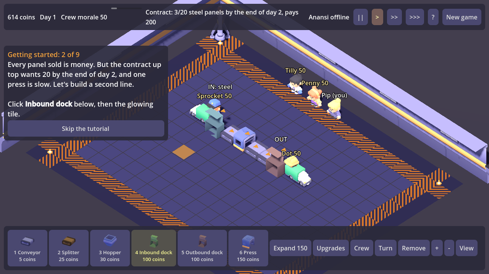

# Hoppertunity

A 3D factory tycoon you play in the browser. You are Pip Hopper, the new floor manager of the Hopper Works, a small
gadget plant on its last chance. Ship five contracts and the plant is saved. Look after the four people who run it,
or it will not be.

**Play it: https://avielbaum.github.io/hoppertunity/** (a desktop browser is best; the first load is about 37 MB)



Built with Godot 4.3 (Compatibility renderer, WebGL 2) and Kenney's CC0 art. This is a playtest build: see
[Known gaps](#known-gaps).

## The game

- **Build a line:** inbound docks order raw materials, conveyors and splitters move them, hoppers buffer them,
  machines turn them into goods, and outbound docks sell them. Steel becomes panels, plastic becomes casings, the two
  become gadgets, and gadgets are boxed; later, copper wire becomes coils and gadgets with coils become smart gadgets.
- **Contracts:** ship a set number of one product before the deadline. Each finished contract unlocks the next machine;
  five save the plant. After each one you choose the next from what Penny, the sales rep, can line up: the happier she
  is, the more offers.
- **The crew:** Dot (docks), Sprocket (machines), Tilly (packing and quality) and Penny (sales) each have a morale from
  0 to 100 that speeds up or slows down their part of the plant. Everyone loses a little each day. Talk to them, do
  their errands, pay fairly. Under 30 on average they walk out for a day.
- **Days:** a day is one minute at normal speed and ends with a report: profit, morale, a chart, and a word from
  whoever had the hardest day. Fall 500 coins into debt and the Works closes.
- **A guided start:** a new game opens on a small line that is already running, and a tutorial walks you through
  building a second one, tile by tile, then on to the crew.
- **Also:** daily events a happy coworker can head off, five plant upgrades, a story per coworker told as you finish
  their errands, and saves in your browser every 20 seconds.

## Controls

Click a build button (or press its number), then the floor; click the button again to put the tool away. Hover a
button to read what the building does. **R** turns the piece or the building under the mouse, right-click cancels the
tool or removes a building for half its price. Drag to lay conveyor; drag the floor to move the view. Click a coworker
to talk, a building to inspect it, an inbound dock to change what it orders. **WASD** or the arrows move the view,
**Q**/**E** turn it, the wheel zooms, **Space** pauses, **M** mutes everything, **N** just the music. The **?** button
has two volume sliders. Everything the keyboard does also has a button in the bottom bar.

## Coworkers that talk (optional)

The coworkers are written for [Anansi](addons/anansi/anansi.gd), a gateway that serves small language models to game
characters; this repository includes its Godot client (`addons/anansi`, MIT or Apache-2.0) but not the gateway. The
hosted game looks for a gateway on your own machine at `http://127.0.0.1:8080`, title `hoppertunity`. If none answers,
which is the normal case, the coworkers use written lines, written errands and written stories, and the game plays the
same; the top bar says "Anansi offline". With a gateway, what you type is answered in character, and the answer can
do exactly five things: lift or lower that coworker's morale a little, offer an errand, share a tip about the next
contract, or ask for a raise. The game owns every number; a model only ever picks words and one of those actions.

## Build and test it yourself

You need [Godot 4.3](https://godotengine.org/download/archive/4.3-stable/).

```
godot --path .                                                        # play on the desktop
godot --headless --path . --import
godot --headless --path . --script res://test/run.gd                  # the checks; the log ends with "0 failed"
godot --headless --path . --export-release Web build/web/index.html   # needs the 4.3 web export template
node test/web.mjs                                                     # Node 22+ and Chrome: does the web build draw?
```

`.github/workflows/pages.yml` does all of that on every push and publishes the web build to GitHub Pages.

| File | What it holds |
|---|---|
| `src/data.gd` | Every number and every written word: items, machines, contracts, the crew, lines, errands, stories |
| `src/sim.gd` | The whole game as plain data on a fixed tick: no nodes, so it runs headless and saves as one dictionary |
| `src/crew.gd` | Every call to the gateway, and what each answer may do to the sim |
| `src/main.gd` | The 3D view, input, interface, tutorial and sound, all built in code |
| `test/checks.gd` | Self-checks, including scripted playthroughs and a run of the real game scene through its screens |

Developer aids in the browser: add `?stress` to the address for the largest floor with every tile a conveyor, and
press **F3** for the frame rate.

## Known gaps

- Nobody has listened to the sound effects or the music in the game yet: they were chosen by name on a machine with
  no audio device. The **?** button has volume sliders.
- The on-screen controls and the phone-sized layout were only tried with a mouse in small desktop windows, never on a
  real phone or tablet. Held upright, the game asks you to turn the device.
- People and vans are for show: where they are changes nothing in the game.
- Balance past the fifth contract rests on one scripted playthrough.

## Licences

The code is MIT or Apache-2.0, at your choice (`LICENSE-MIT`, `LICENSE-APACHE`). The art and sound are CC0, by Kenney
(www.kenney.nl) and Joth: see [assets/LICENSE.md](assets/LICENSE.md).
